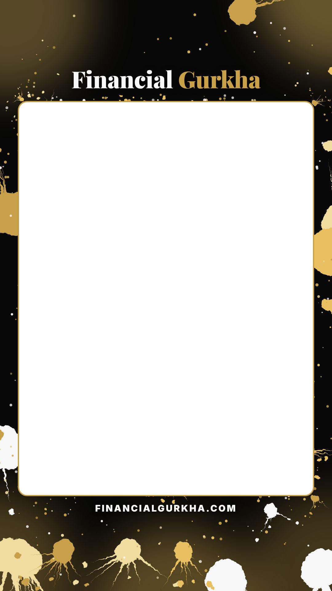

# Video Production: Instagram Reels and TikTok

Muse renders strong video when its inputs are strong. This pipeline exists to hand Muse a **complete, verified, decided** brief, so the creative effort goes into execution, not guessing. Every decision is made upstream of the render.

Related: [content-spec.md](./content-spec.md) (rules for everything published), [production-workflow.md](./production-workflow.md) (roles and git flow), [templates/video-brief.md](./templates/video-brief.md) (the per-video input sheet).

## The tone law

> **No ominous, no doomsday**, in images, voiceover or copy. Neutral to positive: render the facts, keep people informed, steadily build the base. Spectacle and energy, yes. Menace and dread, never, even when the story is a selloff. *(Owner-set, Oct 25, 2026.)*

| Use | Never |
| --- | --- |
| Motion, scale, light, precision, speed | Skulls, sirens, storms-as-doom, cracked earth, burning cities |
| "fell 7%", "biggest one-day drop since July" | "crashed", "collapse", "bloodbath", "panic", "brace yourself" |
| "What it means for you" | Countdowns, warnings, "before it's too late" |
| Black and gold, warm light, gold paint splashes | Red-alarm lighting, horror palettes |

A story about losses is told as **a turn, rendered with energy**: a tipping scale, a leak, a gauge swinging. Never as a threat to the viewer.

## Stages

| # | Stage | Owner | Output |
| --- | --- | --- | --- |
| 0 | Pick the story and angle | Kanchan | Story brief (`docs/templates/story-brief.md`) |
| 1 | Facts, Tier 1/2 source for every one | Muse researches, Claude verifies | Fact table, every row checked |
| 2 | Find the tension and the hardest number | Claude drafts, Kanchan approves | One sentence and one number |
| 3 | Visual concept | Muse, from the abstraction ladder | Ranked concepts and Midjourney prompts |
| 4 | Script | Claude drafts from verified facts, Muse polishes for voice | Timed script, numbers as spoken |
| 5 | Render | Muse | Midjourney plates, animation, Fish voiceover |
| 6 | Assemble | Muse | Video with plates (`npm run plate`) and burned-in subtitles |
| 7 | QA gate | Claude, then Kanchan | Checklist passed |
| 8 | Post | Muse | Instagram Reel, TikTok, Threads, with tracked links |
| 9 | Learn (monthly) | Claude reads the numbers, Muse updates its ladder | Scorecard, updated stage 3 |

## Stage 2: the tension (the most important input)

Don't illustrate the topic. Extract the **turn**: the one contradiction in the story.

- Write it as **"X, yet Y"**: *"Passed every test, yet fails in stress." "Record profits, yet the worst week of the year."*
- Pick **one hardest number**: $24B, 8.6×, $2T. It's on screen in the first frame, and it's the subject of the hook.
- **The thumbnail test:** the tension object and the number must read at thumbnail size in under a second. If it needs a caption to make sense, the concept is too abstract.

## Stage 3: from text to image (the abstraction ladder)

1. **Make it physical.** One object, one event: a crack spreading through a screen, a leak at lunchtime, a scale tipping.
2. **Climb the ladder in the order the evidence ranks:** **spectacle → physical metaphor → mood.** As of Oct 2026, the flying-Roadster reel and the $2T-number carousel top the produced work, and account views went from 33 to 3,852 in 28 days once the engine ran.
3. **Human presence beats polish.** Kanchan's own face and voice out-pull every produced graphic. **Make one founder-on-camera video a week:** 20–40 seconds on the week's biggest number, with Muse adding plates and subtitles.
4. **The house look:** the Gurkha Splash frame (below) around punchy, high-contrast footage with deep blacks and warm gold highlights. No navy.
5. **Midjourney does backgrounds only.** Never text and never numbers; the number is composited at stage 6.

**Prompt pattern:** `scene + tension object + palette + "no text, no words" + aspect flag`

```
a single glass scale on a marble trading desk tipping sharply to one side, Wall Street at dusk through tall windows, cinematic, high contrast, deep black shadows, warm gold highlights, one vivid accent color, no text, no words --ar 3:4
```

Aspect flags: `--ar 3:4` for reel and TikTok footage (it fills the frame's window), `--ar 4:5` for carousels, `--ar 16:9` for the web cover. `npm run video` adds the house style words and the aspect for you.

## Stage 4: the script

**Voice:** Fish Audio "Anchor News" at **1.25×**. Budget **about 3 spoken words per second** of video: a 40-second reel is about 120 words. Leave room to breathe.

| Time | Beat | Rule |
| --- | --- | --- |
| 0–2s | **Hook** | The turn, with the number already on screen. No intro, no logo. |
| 2–8s | Setup | What happened, in one line |
| 8–28s | Evidence | Two or three facts, no more, each from a fact-table row |
| 28–36s | What it means | Neutral or positive: what this means for the viewer |
| 36–40s | Close | "Full breakdown at the link in bio." |

- **Numbers written as spoken:** "five point three six five percent", "twenty-four billion dollars".
- **Every number cites a fact-table row** (`[F3]`) in the script draft, so QA can trace it.
- **No advice:** describe what happened, never what to buy or sell.

## Stage 6: assembly and the frame

### The look: Gurkha Splash

Every reel uses the same frame, built from the logo's colors: near-black `#080808`, off-white `#F8F8F8` and logo gold `#C8A048` (plus lighter and darker golds for the paint). The footage plays in a clean window in the middle; gold and white paint splashes burst out toward the edges. Colors and layout live in `scripts/brand/style.mjs`.



| Zone (1080×1920) | What goes there |
| --- | --- |
| Top, y 0–330 | Paint splashes, and the **Financial Gurkha** wordmark just above the window |
| **Window, x 60–1020, y 330–1610 (3:4)** | The footage. It sits inside Instagram's 3:4 grid crop, so the cover tile shows the whole shot |
| Inside the window, low | Number plate (`--position low`), then the captions just below it at y ≈ 1545 |
| Under the window | `FINANCIALGURKHA.COM`, then splashes. The bottom ~250px is under the platform UI, so nothing important goes there |

- **One frame per series.** `npm run frame -- --seed N` renders a variant with a different splash pattern; set `"frameSeed"` in the storyboard and keep it for the whole series. Committed frames are in `brand/video/frames/`.
- **Captions:** word by word, white Inter Black, up to three words at a time; the word being spoken turns gold and pops. Timed from Fish Audio's word timestamps, so they always match the voice.
- **Motion:** a slow punch-in on every shot keeps the frame alive even when the footage holds.
- **End card:** 1.8 seconds of the stacked wordmark, the tagline and "Full breakdown · link in bio".
- **Loudness:** the final mix is normalized to -14 LUFS, the level Instagram and TikTok play at.
- **Fonts** are bundled in `brand/video/fonts/` (Playfair Display for the wordmark and numbers, Inter Black for captions; both SIL Open Font License), so every machine renders the same frame.

### Making a reel: `npm run video`

Write the script into a storyboard at `production/<YYYY-MM-DD>-<slug>/video.json`, then:

```bash
npm run video -- production/<story>/video.json --dry-run   # check prompts and word counts, no API calls
npm run video -- production/<story>/video.json             # voice, footage, assembly
npm run video -- production/<story>/video.json --scene 03-why --only images,video --force   # redo one shot
```

```jsonc
{
  "title": "<Company> Q3 earnings",
  "frameSeed": 1,
  "voice": { "model": "s2.1-pro", "speed": 1.25 },        // voice id from FISH_AUDIO_VOICE_ID ("Anchor News")
  "midjourney": { "sref": "<style reference, optional>" },
  "music": { "file": "bed.mp3", "volume": 0.1 },           // optional
  "scenes": [
    {
      "id": "01-hook",
      "narration": "[excited] <Company> just made [emphasis] <number, as spoken> in three months.",
      "imagePrompt": "a single gold chip on a black glass table lifting into a column of light",
      "motionPrompt": "slow push-in, light rising",
      "motion": "high",                                      // Midjourney video motion: low | high
      "plate": { "number": "<$NNB>", "label": "<what the number is>", "kicker": "<short hook>" }
    }
  ]
}
```

- One scene per shot, one sentence per scene. Midjourney clips run about 5 seconds, so keep each line around 12–15 words.
- `"imageFile"` uses your own image instead of Midjourney; `"imageIndex"` (1–4) picks another of Midjourney's four candidates.
- Media lands in `production/<story>/render/` (git-ignored); the finished reel is `render/<story>.mp4`.
- Keys go in `.env.local`: `FISH_AUDIO_API_KEY`, `FISH_AUDIO_VOICE_ID`, `APIFRAME_API_KEY`. If APIFrame stops working, set `"videoProvider": "runway"` and add `RUNWAYML_API_SECRET`.

### Voice direction

Fish Audio's S2 voices take delivery cues in square brackets. They steer the read and are never spoken or captioned.

- Open the hook with energy: `[excited]` or `[confident]`.
- Put `[emphasis]` right before the number or word that carries the story.
- Keep cues sparse: one per sentence at most. Over-directed reads sound fake.
- Numbers are still written as spoken: "twenty-four billion dollars", not "$24B".

**Number plates:** render them, don't type them in the editor. Every plate then matches across videos:

```bash
npm run plate -- --number "$24B" --label "Moderna market value, one afternoon" --kicker "The lunchtime leak"
```

- `--number` exactly as it should read. `--label` is one short line, about 45 characters max. `--kicker` stays under about 24 characters, or it wraps.
- `--position low|center|high`, `--format reel|carousel|square`, `--out path`.
- The output is a transparent PNG in `plates/` (git-ignored). Lay it over the video in the editor.

**The cover frame:** pick the frame with the tension object and the plate both visible. It becomes the grid tile on Instagram and on `/links`.

## Stage 7: QA gate

Claude checks first, then Kanchan approves. Nothing posts until every box is ticked.

- [ ] Every number on screen and in the voiceover traces to a verified fact-table row
- [ ] **Tone law:** no menace in the image, voiceover or copy
- [ ] The number is a rendered plate; no AI-generated text anywhere in the frame
- [ ] The hook lands in the first 2 seconds, with the number visible
- [ ] Tension object and number sit inside the 3:4 grid crop
- [ ] Subtitles burned in, readable, clear of the platform UI
- [ ] Voiceover within the word budget, numbers spoken correctly
- [ ] No buy/sell language; "Not investment advice" in the caption
- [ ] Meta's AI label set (AI images and voice); TikTok's AI-generated content label set
- [ ] Tracked link in bio: `/links?utm_source=instagram&utm_content=reel-YYYYMMDD` (and `utm_source=tiktok` for TikTok)

## Stage 9: learn, monthly

Re-derive, don't assume. What worked is evidence, not taste. Each month, Claude pulls for every post:

- Views and reach.
- 3-second hold and average watch time (how much of the video people stay for).
- Shares and saves.
- Profile visits.
- **Website clicks:** `links-card-click` events by `utm_content` in PostHog. These show which posts turned into readers.

Results go in `production/<story>/results.md`. The monthly summary ranks formats: spectacle vs physical metaphor vs mood vs founder-on-camera. **Stage 3's ladder order is rewritten from that ranking.** When it changes, the owner is told what changed and why.
